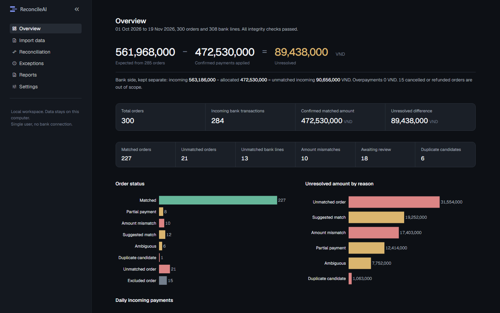
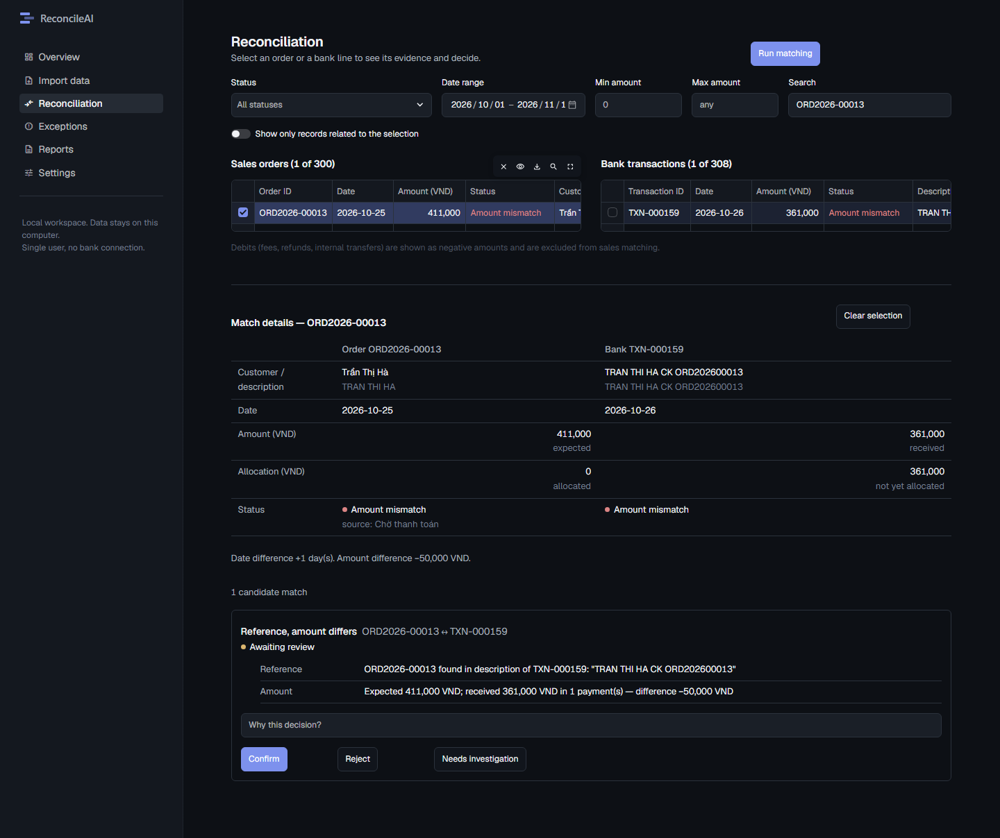
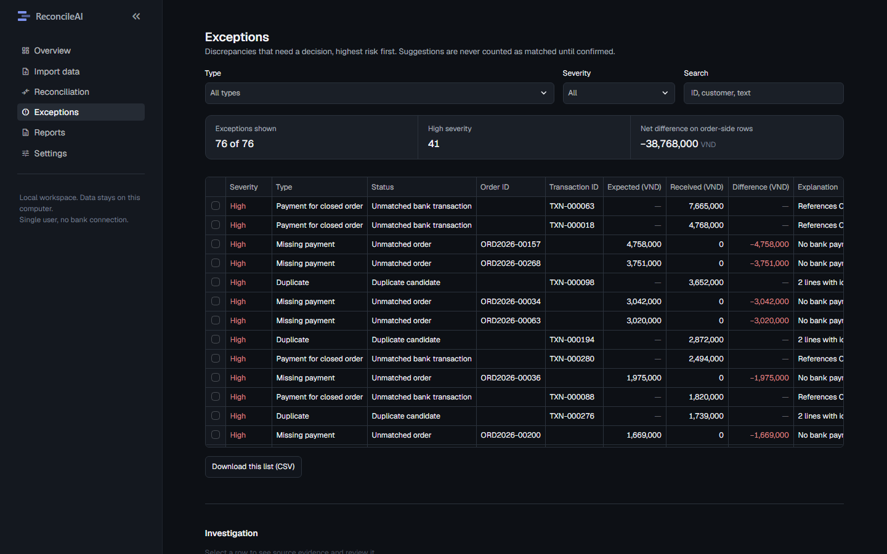
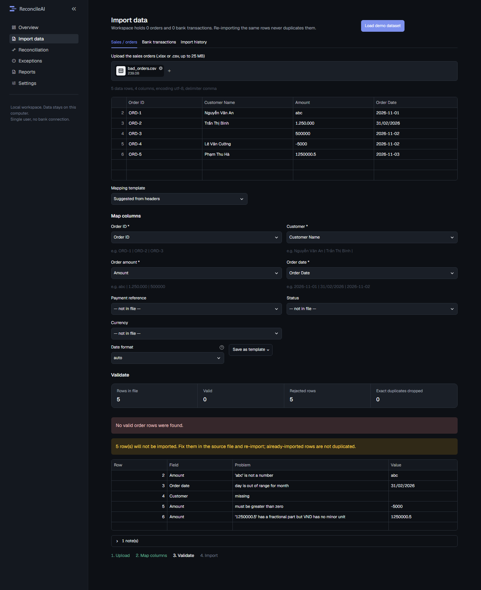
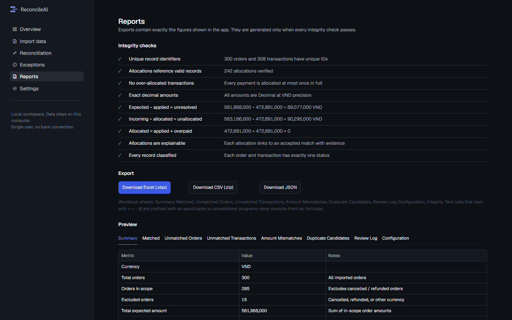
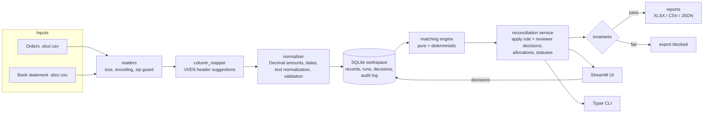
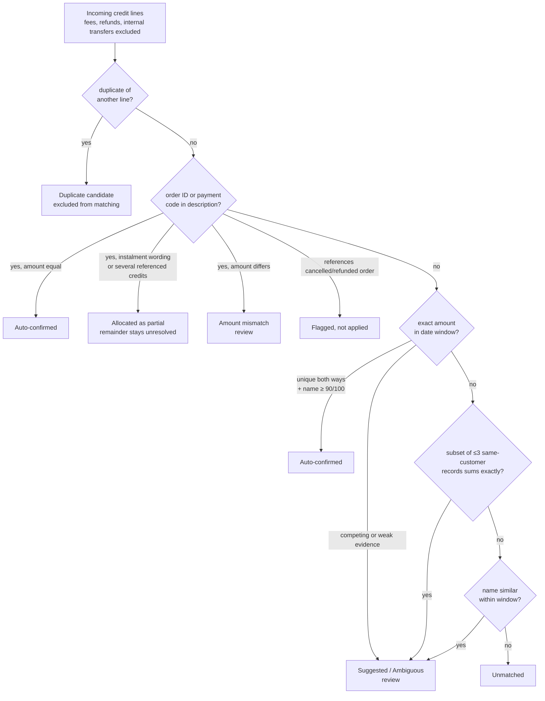

# ReconcileAI

**Local-first payment reconciliation.** ReconcileAI compares sales orders against bank-statement lines, matches payments with an explainable multi-stage engine, flags discrepancies, records every review decision, and exports an auditable Excel report. Every amount is an exact `Decimal`. Reports are blocked unless the books balance.



> All data in this repository is **fictional** and generated by `reconcileai demo`. The app never connects to a bank and never moves money.

---

## Why

Small and mid-sized businesses in Vietnam still reconcile bank transfers against orders by hand. Customers type free-text transfer notes (`NGUYEN VAN AN CK ORD2026-00125`, `ck don ord2026 00125`, or just their name), pay in instalments, pay twice, pay the wrong amount, or pay for an order that was cancelled. A spreadsheet `VLOOKUP` silently gets these wrong.

ReconcileAI treats this as a data-quality and accounting problem:

- **Precision before recall.** A wrong automatic match is worse than an unmatched line, so anything uncertain goes to a human.
- **Explainability.** Every match lists the evidence behind it: reference found, exact amount, date gap, name similarity with its meaning.
- **Integrity.** Accounting invariants are verified after every run, and exports refuse to run if any check fails.

## What it does

| Area | Capability |
|---|---|
| Import | XLSX and CSV (UTF-8, UTF-8 BOM, Windows-1258 Vietnamese, `,` `;` tab delimiters); worksheet selection; Vietnamese and English header auto-mapping; saved mapping templates; preview; validation report |
| Validation | Missing fields, invalid or ambiguous amounts, impossible or ambiguous dates (day/month never guessed), negative values, unsupported currencies, duplicate IDs, empty rows, corrupted or oversized files |
| Matching | 1) reference, 2) exact amount + date window ranked by name evidence, 3) composite (split payments, one transfer for several orders), 4) fuzzy-name suggestions, 5) conflict annotation |
| Review | Confirm, reject, needs-investigation, undo, manual match; notes; append-only audit log; decisions survive re-runs |
| Statuses | Matched, Suggested, Unmatched order, Unmatched bank transaction, Amount mismatch, Duplicate candidate, Partial payment, Overpayment, Ambiguous, Ignored, Excluded order, Needs investigation |
| Integrity | 9 invariants, including *expected − applied = unresolved*, *incoming − allocated = unallocated*, and no over-allocated transaction |
| Reports | 9-sheet Excel workbook (summary, matched, unmatched orders and transactions, mismatches, duplicates, review log, configuration, integrity), plus CSV zip and JSON; formula-injection safe |
| Interfaces | Streamlit app (6 pages) and a Typer CLI that share one engine |

## Screens

| Reconciliation workspace: evidence and decision | Exceptions: risk-ordered discrepancy list |
|---|---|
|  |  |
| **Import: validation of a broken file** | **Reports: integrity gate and exports** |
|  |  |

A light theme is also available (`⋮ → Settings → Theme`): [screenshot](assets/screenshots/overview_light.png).
All screenshots are real captures from `scripts/capture_screenshots.py` (Playwright + Chromium).

## Architecture



The **engine** produces candidates (expensive, deterministic, cached by an input fingerprint). The **service** applies decisions and computes allocations (cheap, re-run on every click). Source records are never modified. Details: [docs/ARCHITECTURE.md](docs/ARCHITECTURE.md).

## How matching works



- **Reference keys** are compact, so `ORD2026-00125`, `ORD202600125`, `ord2026 00125` and `ORD2026.00125` are all the same key.
- **Name similarity** aligns tokens one by one, with the given name weighted ×2. Vietnamese names share family and middle names (`NGUYEN VAN AN` vs `NGUYEN VAN BINH`), and generic fuzzy ratios score those pairs ~87. This scorer gives them 50.
- **Scores rank candidates; they are not probabilities.** The UI says so next to every score.
- **No double allocation.** A payment's allocations can never exceed its amount. Competing suggestions are superseded when one is confirmed, and a conflicting confirmation is *blocked* with a reason rather than applied.

Full rules, weights and limits: [docs/MATCHING_ALGORITHM.md](docs/MATCHING_ALGORITHM.md).

## Financial accuracy

- Amounts are `decimal.Decimal`, quantized to the currency's minor unit (VND 0, USD/EUR 2). Floats from Excel cells go through `repr` and are **rejected, not rounded**, if they carry extra precision.
- `1.250.000`, `1,250,000` and `1 250 000 đ` all parse to VND 1250000. For USD, `1.250` is **rejected as ambiguous** instead of guessed.
- Currencies are never mixed and no exchange rate is ever inferred. Records in another currency are kept and shown as excluded.
- The reconciliation equations are checked on every run:

```
Expected receivable (in-scope orders)  −  Applied payments  =  Unresolved expected amount
Incoming customer credits              −  Allocated         =  Unmatched incoming amount
Allocated                              =  Applied  +  Overpaid
```

Unmatched incoming money is reported separately and never netted against missing order payments. Cancelled and refunded orders are out of scope for receivables. Credits that reference them are flagged, and outgoing refunds and fees are reported on their own lines.

## Evaluation (real results on generated data)

`reconcileai evaluate demo/ground_truth.json`. The ground truth is written by the **generator** from the scenarios it builds, never by the matcher. Unit: one `(order, bank transaction)` association.

| Dataset | True associations | Auto precision | Auto recall | Incorrect auto matches | Found auto **or** suggested |
|---|---|---|---|---|---|
| Challenging (300 orders, 308 lines, 16 anomaly types) | 272 | **100.0%** | 88.6% | 0 | 100% |
| Clean (300 orders, 285 lines) | 285 | 100.0% | 98.9% | 0 | 100% |
| 10 more seeds, challenging (300 orders each) | — | 100.0% on every seed | 87.5–89.7% | 0 | 99.3–100% |

The 31 associations not auto-matched in the challenging set are by design: same-name and same-amount pairs, composite payments without references, under- and overpayments, and partial names that score below the auto-confirm threshold. All of them are surfaced for review. Duplicate-line detection hit 5/5, and 6/6 payments on cancelled or refunded orders were flagged with none allocated. See [docs/EVALUATION.md](docs/EVALUATION.md), including why 100% precision on synthetic data **does not** mean 100% on real statements.

## Performance (measured, `scripts/benchmark.py`)

Windows 11, Python 3.12.10, Intel Core (family 6 model 183), single process:

| Orders / bank lines | Read XLSX | Normalize + validate | Matching | Allocate + invariants | XLSX report | Peak memory (matching) |
|---|---|---|---|---|---|---|
| 300 / 308 | 0.04 s | 0.09 s | 0.05 s | 0.03 s | 0.11 s | 0.8 MB |
| 1,000 / 1,037 | 0.09 s | 0.28 s | 0.18 s | 0.11 s | 0.23 s | 2.7 MB |
| 5,000 / 5,176 | 0.40 s | 1.44 s | 1.35 s | 0.95 s | 1.95 s | 12.7 MB |

Every stage uses blocking (amount buckets, date windows, a reference index), so no stage compares all records against all others. Timings vary between runs on the same machine (the 5,000-row normalize step measured 1.4–2.9 s across runs); the table is the latest run in `docs/benchmark_results.json`.

## Quick start (Windows)

1. Install [Python 3.12+](https://www.python.org/downloads/) (tick *Add to PATH*).
2. Clone the repository and double-click **`START_RECONCILEAI.bat`**.
   The first run creates `.venv` and installs dependencies (about 1–2 minutes). Later runs start in a few seconds.
3. The browser opens at `http://localhost:8501`. Click **Load demo dataset**.

Manual alternative:

```powershell
py -3.12 -m venv .venv
.venv\Scripts\pip install -r requirements.txt
.venv\Scripts\pip install --no-deps -e .
.venv\Scripts\streamlit run app.py
```

The server listens on `127.0.0.1` only (see `.streamlit/config.toml`).

## CLI

```powershell
reconcileai demo --generate                      # fictional dataset + ground truth in demo/
reconcileai validate demo/data/bank_statement.csv
reconcileai run --orders demo/data/orders.xlsx --bank demo/data/bank_statement.xlsx --output reports/ --formats xlsx,csv,json
reconcileai evaluate demo/ground_truth.json --min-precision 0.99
```

Exit codes: `0` OK, `1` import/validation error, `2` integrity check failed, `3` precision below `--min-precision`.

## Testing

```powershell
scripts\test.ps1        # ruff + 109 pytest tests + CLI smoke test
.venv\Scripts\python scripts\capture_screenshots.py   # 24 browser checks + screenshots
```

Tests cover money parsing (including Hypothesis round-trips), Vietnamese text, every importer error path, each matching edge case (identical amounts, similar names, partial, split, multi-order, fees, cancelled, refunded, currency mismatch, duplicates across imports), decisions and undo, double-allocation blocking, idempotent re-runs, invariant violations blocking reports, formula-injection safety, persistence transactions, the CLI, and the evaluation regression thresholds. A property-based test applies random decisions to random datasets and asserts that every invariant holds.

CI runs ruff, pytest and the CLI smoke test on Ubuntu and Windows (`.github/workflows/ci.yml`).

## Security and privacy

- Local only: no network calls, no bank APIs, no AI APIs. The server binds to `127.0.0.1`.
- Upload limit 25 MB, row limit 200,000, XLSX zip-bomb guard, and formulas are never evaluated on import.
- Exports prefix any text cell starting with `= + - @` with an apostrophe (CSV/formula injection).
- `data/`, `reports/`, `.env` and local settings are git-ignored. Only generated fictional data is committed.

More in [docs/SECURITY.md](docs/SECURITY.md).

## Limitations

- Single user, no authentication. "Actor" in the audit log is recorded as `local user`, because the app cannot verify identity.
- No exchange-rate conversion. Multi-currency records are excluded, not converted.
- Evaluation uses synthetic data written by the same author as the matcher (see EVALUATION.md). Real bank narratives are messier.
- Reference detection needs order IDs that contain digits. Purely alphabetic payment codes are not indexed.
- Composite matching searches at most 3 records from a pool of 10 per payment, so larger splits must be matched manually.
- Streamlit's row selection is per table. Selecting an order and a payment together is how a manual match is made.

## Roadmap

- Per-bank description parsers (VCB, TCB, MB) and VietQR reference extraction.
- Fee-aware matching: an explicit "bank fee" adjustment type when a known fee explains the difference.
- Multi-user mode with authentication and per-user audit identity.
- Scheduled imports from SFTP or e-mail statements.

## Project layout

```
app.py                      Streamlit entry point
src/reconcileai/
  money.py text.py config.py models.py pipeline.py evaluation.py demo_data.py cli.py
  ingestion/   readers, column_mapper, normalizer
  matching/    exact_match, fuzzy_match, composite_match, duplicate_detection, scoring, engine
  reconciliation/  service, invariants, exceptions
  reports/     tables, exporters
  persistence/ database (SQLite)
  ui/          theme, state, components, overview, import_data, reconciliation, exceptions, reports, settings
tests/                      109 tests
scripts/                    setup/start/test .ps1, benchmark.py, capture_screenshots.py
demo/                       fictional datasets + ground truth
docs/                       architecture, algorithm, evaluation, design system, demo script, security
.claude/skills/             project design and QA skills used to build the UI
```

## License

[MIT](LICENSE)
