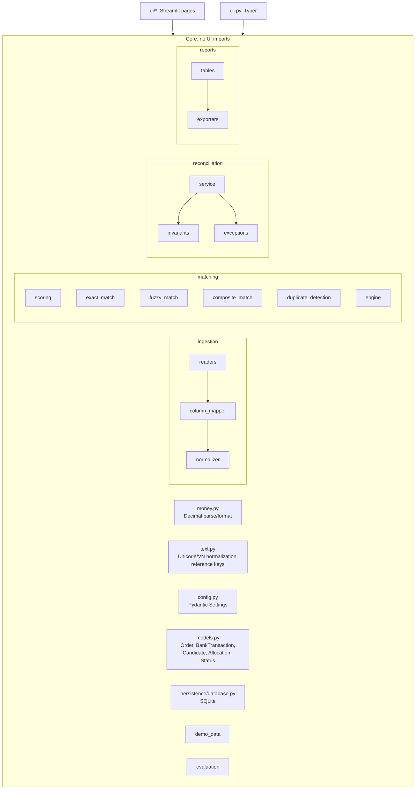
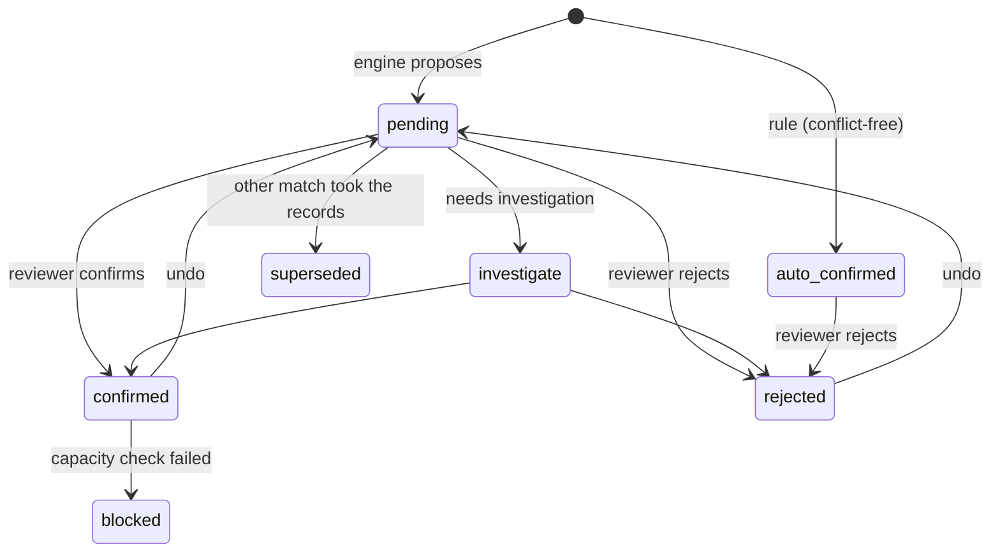

# Architecture

## Principles

1. **Source records are immutable.** Imports create `Order` / `BankTransaction` records (frozen dataclasses). Matching and review never edit them. Decisions live in their own append-only table.
2. **Pure engine, cheap service.** `run_matching()` is deterministic and has no side effects. `reconcile()` applies rule and reviewer decisions on top and recomputes every status, total and invariant. It is fast enough to run after every click.
3. **One code path.** The Streamlit UI and the CLI both call `pipeline` → `run_matching` → `reconcile` → `reports.tables`. Exports are built from the same tables the UI previews.
4. **Fail closed.** If an invariant fails, `build_tables()` raises `IntegrityError` and no report is produced.

## Modules

| Module | Responsibility |
|---|---|
| `ingestion/readers.py` | Size limit, encoding detection (UTF-8, BOM, UTF-16, Windows-1258), delimiter sniffing, XLSX zip-bomb guard, worksheet selection, empty-row removal, spreadsheet row numbers |
| `ingestion/column_mapper.py` | Synonym and fuzzy header mapping (VI/EN), required-field check, JSON mapping templates |
| `ingestion/normalizer.py` | Per-row validation into typed records. Column-level date-order resolution (never guessed), currency check, txn classification, duplicate-row handling |
| `matching/*` | Candidate generation (see MATCHING_ALGORITHM.md) |
| `reconciliation/service.py` | Decision application, allocation with capacity checks, statuses, summary totals |
| `reconciliation/invariants.py` | 9 accounting checks plus `require_integrity` |
| `reconciliation/exceptions.py` | Discrepancy list with severity |
| `reports/tables.py` | The 8 report tables, formula-injection sanitizer |
| `reports/exporters.py` | XLSX (formats, freeze panes, filters, conditional formats), CSV zip, JSON (exact decimal strings) |
| `persistence/database.py` | Workspace: imports (idempotent merge), runs, candidates, allocations, decisions, audit log, settings |
| `demo_data.py` / `evaluation.py` | Fictional data with ground truth, plus metrics |

## Data flow for one review click

1. The user presses **Confirm** on candidate `C-…`.
2. `Workspace.add_decision()` appends a row to `decisions` and an `audit_log` event inside one transaction.
3. Streamlit reruns. `state.current()` loads records and decisions. The cached `MatchResult` is reused because the input fingerprint is unchanged.
4. `reconcile()` rebuilds allocations from scratch (rule confirmations, then reviewer confirmations in timestamp order), recomputes statuses and totals, and runs the invariants.
5. Every page shows the new numbers. Nothing incremental is stored, so derived state cannot drift.

## SQLite schema (summary)

| Table | Key | Notes |
|---|---|---|
| `import_sessions` | id | per-file counts (added, unchanged, conflicting, rejected) plus a JSON report |
| `orders` | `order_id` PK | amounts stored as exact decimal TEXT |
| `bank_transactions` | `txn_id` PK | raw description **and** normalized text |
| `runs` | id | input fingerprint, settings snapshot, summary, integrity flag |
| `candidates` | (run_id, candidate_id) | rule, score, state, evidence JSON |
| `allocations` | run_id | order, txn, amount, candidate, source (`rule:*` or `review`) |
| `decisions` | id | append-only (triggers block UPDATE, and block DELETE while records exist) |
| `audit_log` | id | every import, decision, run, settings change and clear |
| `settings` | id = 1 | current Settings JSON |

Re-importing a file merges by ID: identical rows are counted as *unchanged*, while rows with a known ID but different content are reported as *conflicting* and **not** overwritten.

## Reconciliation state machine (candidate)

## Why Streamlit

The brief asked for Streamlit. To keep business logic testable, every page is a thin `render()` function, and everything financial lives in `src/reconcileai` with no Streamlit imports.
